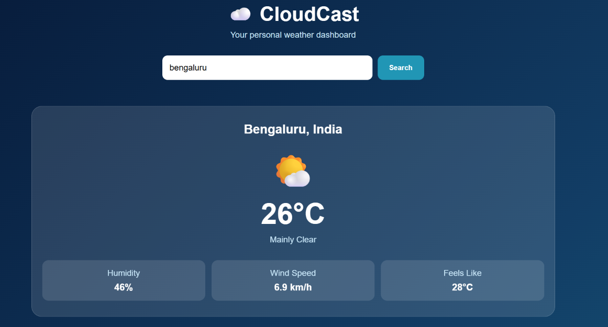

# cloudcast# ☁️ CloudCast – Weather, Made Clear.

**A modern, responsive weather dashboard that brings real-time weather conditions, hourly forecasts, and a 7-day outlook together in one place.**

CloudCast started with a simple idea: checking the weather shouldn't mean navigating through cluttered apps, confusing information, or unnecessary distractions.

I built CloudCast as a hands-on project to explore how web applications communicate with external APIs, process live data, and transform that data into a clean, interactive user experience.

What began as a simple city-based weather search gradually evolved into a dashboard that provides both a quick snapshot of current conditions and a broader view of the days ahead.

---

## 🌤️ Features

- **Current Weather:** View the current temperature, weather conditions, humidity, wind speed, and feels-like temperature.
- **24-Hour Forecast:** Explore upcoming hourly temperatures, weather conditions, and precipitation probability.
- **7-Day Forecast:** Check daily weather conditions alongside maximum and minimum temperatures.
- **City Search:** Search for cities around the world.
- **Dynamic Weather Icons:** Weather conditions are represented through visual icons.
- **Responsive Design:** Designed to work across desktop and mobile screen sizes.
- **Live Weather Data:** Fetches weather information using the Open-Meteo API.

## 🖥️ Preview

<!-- Add your project screenshot here -->
<!-- Upload a screenshot to your repository and replace the line below -->



## 🛠️ Built With

| Technology | Purpose |
|---|---|
| HTML5 | Application structure |
| CSS3 | Styling, layout, and responsive design |
| JavaScript | Application logic and dynamic updates |
| Open-Meteo API | Weather forecast data |
| Open-Meteo Geocoding API | City search and location coordinates |

## ⚙️ How It Works

CloudCast follows a simple data flow:

1. **User Input:** The user enters a city name.
2. **Geocoding:** The Geocoding API identifies the city and returns its latitude and longitude.
3. **Weather Request:** JavaScript uses those coordinates to request weather information from Open-Meteo.
4. **Data Processing:** The application processes the API response and maps weather codes to readable descriptions and icons.
5. **Dynamic Display:** The dashboard updates to display current conditions, hourly forecasts, and the 7-day forecast.

This project helped me understand how APIs, asynchronous JavaScript, JSON responses, and DOM manipulation work together in a real application.

## 📁 Project Structure

```text
CloudCast/
│
├── index.html       # Application structure
├── style.css        # Styling and responsive layout
├── script.js        # API integration and application logic
│
├── screenshots/
│   └── cloudcast-preview.png
│
└── README.md
```

## 🚀 Getting Started

Run CloudCast locally in a few simple steps.

**1. Clone the repository**

```bash
git clone https://github.com/YOUR-USERNAME/CloudCast.git
```

**2. Navigate to the project folder**

```bash
cd CloudCast
```

**3. Open the application**

Open `index.html` in your browser, or use the Live Server extension in Visual Studio Code.

No API key, backend server, or additional dependencies are required.

## 🌍 API Credits

Weather information is provided by [Open-Meteo](https://open-meteo.com/).

- [Open-Meteo Weather API](https://open-meteo.com/en/docs)
- [Open-Meteo Geocoding API](https://open-meteo.com/en/docs/geocoding-api)

## 🎯 What I Learned

Building CloudCast gave me practical experience with:

- Working with third-party REST APIs.
- Understanding HTTP requests and JSON responses.
- Using JavaScript `fetch()`, `async/await`, and error handling.
- Manipulating the DOM dynamically.
- Creating responsive layouts using CSS Grid and Flexbox.
- Breaking a project into smaller, manageable development milestones.

More importantly, it helped me move from understanding individual programming concepts to seeing how they work together in a functional application.

## 🔮 Future Improvements

CloudCast is an ongoing learning project. Planned improvements include:

- [ ] Location-based weather detection.
- [ ] Weather charts and temperature trends.
- [ ] Sunrise and sunset information.
- [ ] UV index and additional weather metrics.
- [ ] Improved loading states and animations.
- [ ] Deployment and cloud-hosting exploration.

## 👨‍💻 Developer

**Mandala Jenith**

BCA – Cloud Computing Student

Interested in software development, cloud computing, and building practical technology projects.

---

*CloudCast is a learning project built to explore frontend development, API integration, and real-world application development.*

**Weather changes. Your curiosity shouldn't. ☁️**
